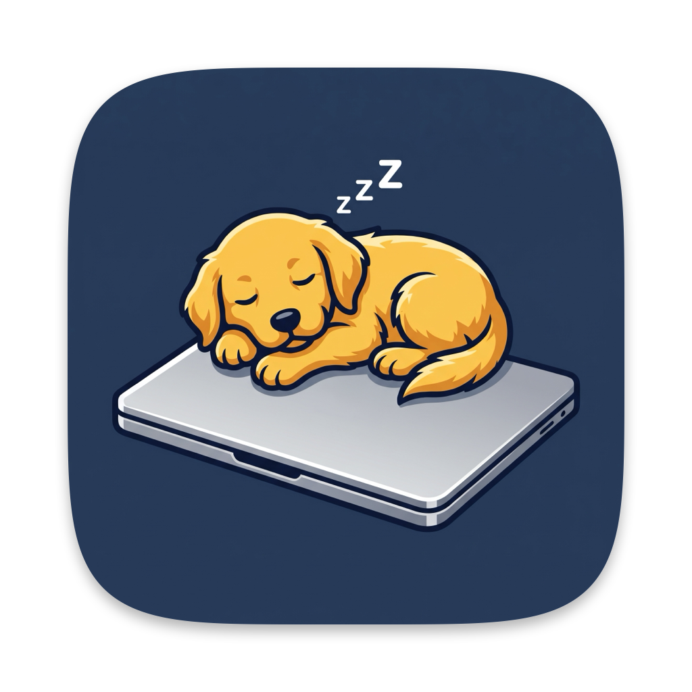

# SleepGuard



A macOS menu bar toggle for `pmset disablesleep` that always expires.

`sudo pmset -a disablesleep 1` keeps a Mac awake even with the lid closed, and stays on until someone remembers to turn it off. SleepGuard puts that switch in the menu bar and gives every "keep awake" an end time, so a forgotten toggle cannot run through the night or drain a laptop in a bag.

Requires macOS 13 or later.

## Install

From a release:

```sh
gh release download --repo nemofpv/sleep-guard --pattern '*.zip'
unzip SleepGuard-*.zip
mv SleepGuard.app /Applications/
open /Applications/SleepGuard.app
```

A zip downloaded with a browser is quarantined, and the app is signed ad hoc rather than notarized. Clear the quarantine once before opening it:

```sh
xattr -dr com.apple.quarantine /Applications/SleepGuard.app
```

From source (needs the Xcode Command Line Tools):

```sh
scripts/build.sh
cp -R build/SleepGuard.app /Applications/
```

To start it at login, add it under System Settings → General → Login Items.

## Stop the password prompts

Changing `disablesleep` needs root. Out of the box, macOS therefore asks for an admin password every time SleepGuard turns keep-awake on or off, including the automatic turn-off when the time runs out. To stop that, run this once:

```sh
sudo /Applications/SleepGuard.app/Contents/Resources/install.sh
```

From a checkout the same script is `sudo scripts/install.sh`. It installs two things:

- **A sudoers rule** in `/etc/sudoers.d/sleepguard` that lets your user run exactly two commands without a password: `pmset -a disablesleep 0` and `pmset -a disablesleep 1`. Nothing else becomes passwordless.
- **A backstop** in `/Library/LaunchDaemons/local.sleepguard.enforce.plist` that checks every 5 minutes as root and re-enables sleep once the expiry has passed. With it, the expiry holds even if the app has quit or crashed.

The rule is for the user who ran `sudo`; to set it up for someone else, pass the user name: `sudo …/install.sh alice`.

To undo both: `sudo /Applications/SleepGuard.app/Contents/Resources/uninstall.sh`

## Using it

Click the menu bar icon and pick how long to stay awake:

| Choice | Lasts until |
|---|---|
| Keep awake until 23:00 | tonight's cutoff; between 23:00 and 07:00 this is 2 hours instead |
| Keep awake for 1h / 2h / 4h | that long from now |
| Keep awake overnight | the next 07:00 |
| Keep awake indefinitely | you turn it off |

While it is on, the icon is a coffee cup with the time left, and the menu offers **Allow sleep now**, **Extend +1h / +2h** and a switch to or from indefinitely.

**Allow sleep when unplugged** (on by default) ends keep-awake within 15 seconds of the Mac going onto battery. While it is checked and the Mac is on battery, the keep-awake choices are greyed out.

## What happens when…

| Situation | Result |
|---|---|
| You run `sudo pmset -a disablesleep 1` in a terminal | Within 15 seconds SleepGuard adopts it and gives it the default expiry, as if you had picked "Keep awake until 23:00". On battery with "Allow sleep when unplugged" checked, it is turned off instead. |
| The same, but SleepGuard is not running | With the backstop installed, sleep is re-enabled within about 5 minutes. Without it, sleep stays disabled until SleepGuard is next started, which then adopts it. |
| You run `sudo pmset -a disablesleep 0` during a keep-awake | SleepGuard notices within 15 seconds, discards the expiry and notes it in the menu. A later manual enable starts fresh. |
| The expiry passes | Sleep is re-enabled by the app, or by the backstop within 5 minutes if the app is not running. |
| The expiry passes and the sudoers rule is not installed | macOS asks for an admin password. If nobody answers or the prompt is cancelled, the icon becomes a warning triangle and SleepGuard asks again every 5 minutes. **Allow sleep now** retries at once. |
| You quit SleepGuard during a keep-awake | With the backstop installed the expiry is still enforced. Without it, Quit re-enables sleep first. |
| SleepGuard crashes or is force-quit, no backstop | Sleep stays disabled until SleepGuard runs again. This is the case the backstop exists for. |
| `/Users/Shared/SleepGuard/expires-at` is deleted or holds anything but a timestamp | It counts as "no expiry". The app assigns the default expiry; if the app is not running, the backstop re-enables sleep. |

## Development

```sh
scripts/test.sh     # policy tests, then enforce.sh against a fake pmset
scripts/build.sh    # build/SleepGuard.app
```

Neither touches the real power settings. Running the app does.

GitHub Actions runs both on every push that changes the sources, tests, scripts or icon. Pushes that only touch documentation are skipped.

| Path | Contents |
|---|---|
| `Sources/SleepGuard/Policy.swift` | The decisions: parsing, expiry arithmetic, what each 15-second tick should do. No I/O. |
| `Sources/SleepGuard/main.swift` | The menu and the I/O: `pmset`, the expiry file, the power source. |
| `scripts/enforce.sh` | The backstop that the LaunchDaemon runs as root. |
| `scripts/install.sh`, `uninstall.sh` | Set up and remove the sudoers rule and the backstop. |
| `scripts/make-icon.swift` | Rebuilds `Resources/AppIcon.png` from `Resources/icon-source.jpg`. |
| `Tests/` | The test programs that `scripts/test.sh` runs. |

## Releasing

Push a version tag:

```sh
git tag v1.0.0
git push origin v1.0.0
```

The Release workflow runs the tests, builds a universal (Apple silicon and Intel) app with that version, and publishes `SleepGuard-1.0.0.zip` with a SHA-256 checksum as a GitHub release. Running the workflow by hand from the Actions tab does a dry run: the same build, kept as a workflow artifact, with nothing published.
